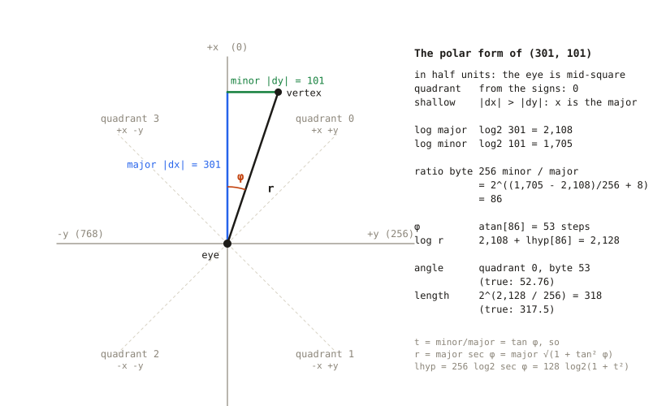
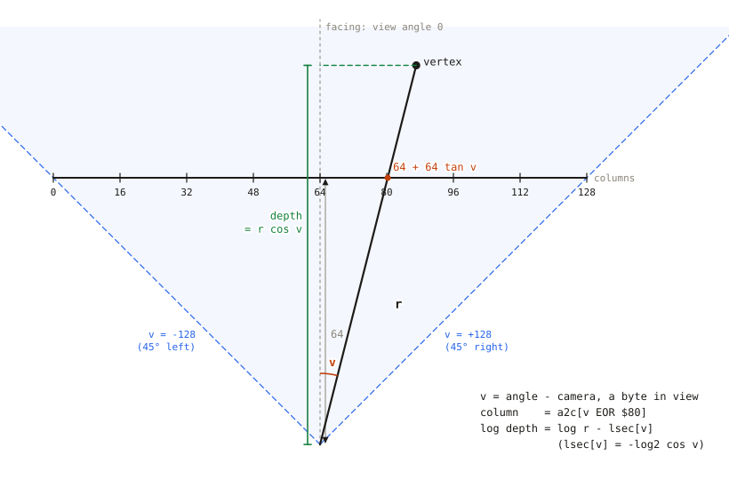
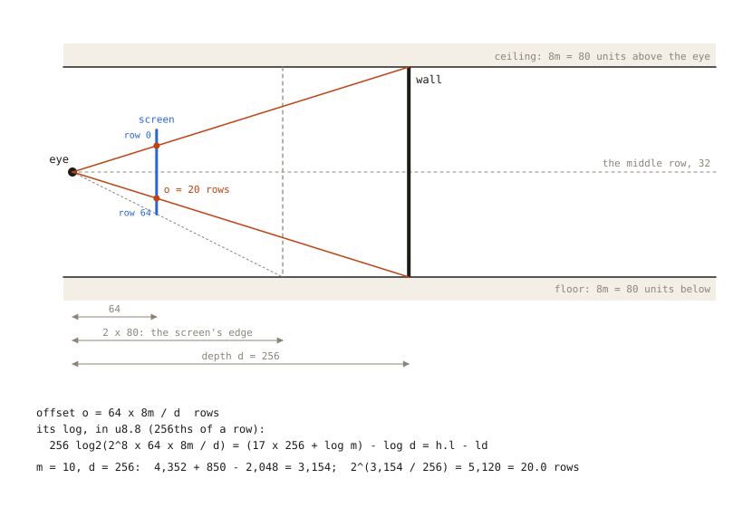
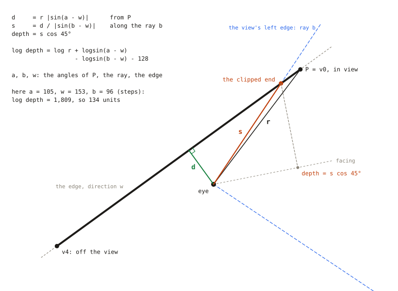
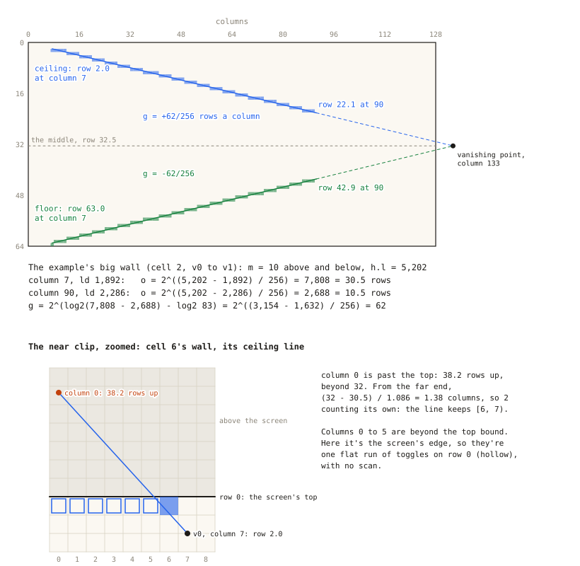
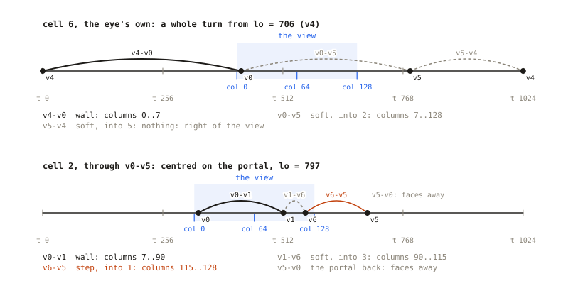
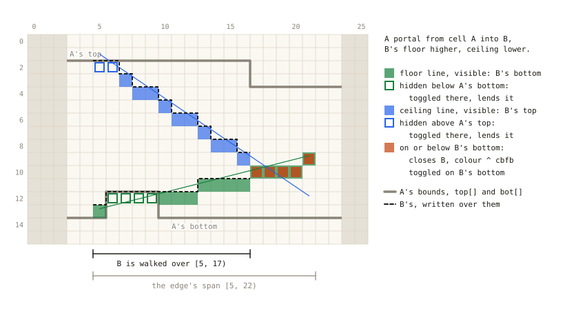
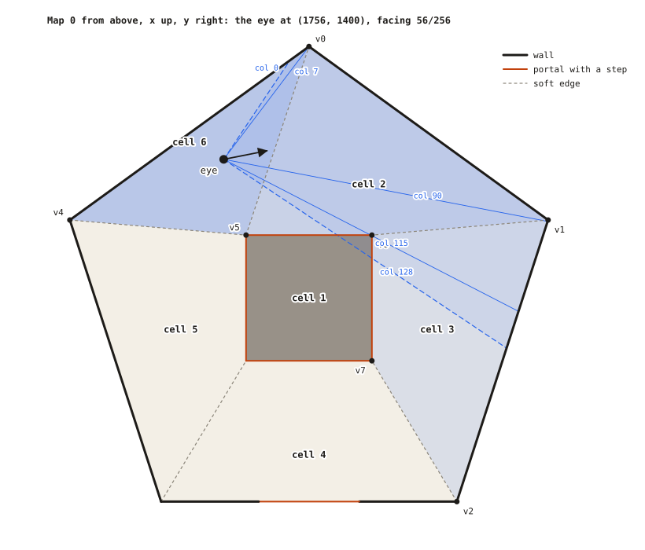
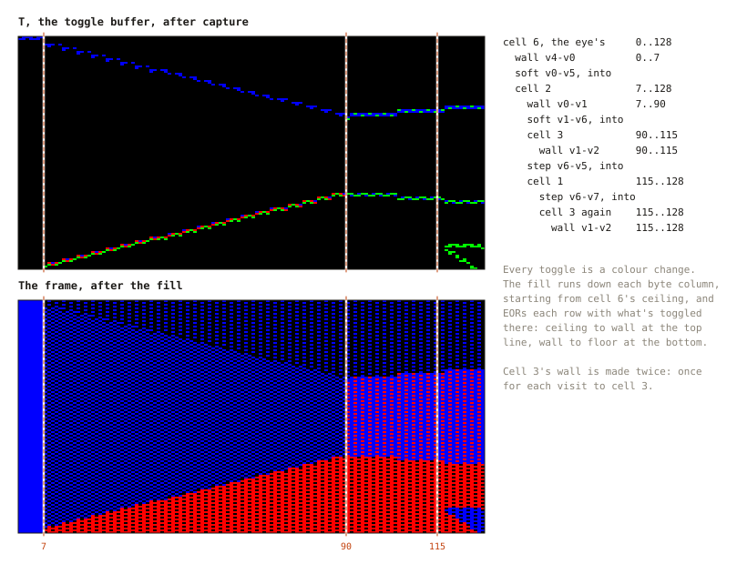
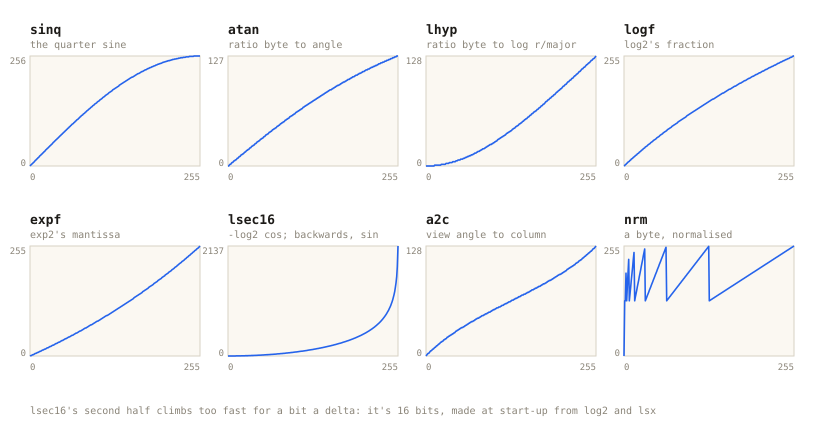

# How it works

A tour of one frame on `polar`, from the camera's tick to the finished
picture, with every piece of maths derived from scratch and the tables it
leans on. NOTES.md is the notebook: what I tried, what I kept, and why. This
is just how it goes now.

The C is a model of the BBC build, so it's written the 6502's way: bytes
where bytes will do, tables instead of multiplies, signs held apart from
magnitudes. Cycles are a 2 MHz 6502's. Some are measured on `main`'s port,
some come from the cost model in NOTES.md, and I say which.

The worked numbers come from one real frame: map 0's demo pose, the eye at
(1756, 1400) in cell 6, facing 56/256 of a turn. It's laid out in full under
A real frame, near the end. The camera's collision maths isn't here; NOTES.md
has it.

## The screen

The picture is 128 columns by 64 rows. A row is a pair of scanlines, each
with its own dither pattern, which is how a four-colour MODE 5 screen gets
35 shades. Four pixels to a byte, in the BBC's character-cell layout.

Nothing is drawn as a polygon. Every line is a colour change, and the
picture comes from a fill that runs down each byte column. If T(r) is
what's toggled on row r, the fill writes

```
S(r) = start ⊕ T(0) ⊕ T(1) ⊕ ... ⊕ T(r)
```

where ⊕ is EOR and start is the colour above the screen (the eye's cell's
ceiling). So to go from colour a to colour b at row r, toggle a ⊕ b there:
everything above stays a, and from r down it's a ⊕ a ⊕ b = b. Column 40 of
the example frame:

```
row   toggled in T          the screen after the fill
 0                          ceiling
 9    ceiling ⊕ wall        ceiling ⊕ (ceiling ⊕ wall) = wall
55    wall ⊕ floor          wall ⊕ (wall ⊕ floor) = floor
63                          floor
```

So capture's whole job is to put the right toggles in the right places,
in a toggle buffer, T. The fill turns T into the picture. Two toggles per
column for a wall, a few more for a doorway, and it never cares how many
polygons there were.

## A frame, top to bottom

```
pt_camera_tick           camera.c   turn, move, slide off walls; the vertex
                                    cache looks from the new spot; which cell
pt_render_view           render.c
  frame
    root_walk                       the eye's cell, from the side across the
                                    view's left edge
    walk                            the cell's sides in turn, clockwise
      process_edge                  a side: its columns, its lines, its child
        edge_ends                   its ends: in view by lsec, off it by
                                    Doom's clipper
        make_line                   rows and gradient, from logs
        clip_plain/floor/ceil       against top[] and bot[], plotted into T
        enter                       the child's visit
      descend -> walk               the child, recursively (the last one is
                                    a tail call)
    pt_mode5_fill        mode5.c    T into the back buffer
    pt_sprite_plot       sprite.c   sprites over that, far to near
    unplot                          T back to zero, from the records
```

The camera ticks at a fixed rate. Each tick turns it, moves it with sliding
collision against walls and posts, and tells the vertex cache where the eye
is now. The cache then works out which cell the eye is in. Capture uses
the same cache and starts from the same cell, so the camera and the picture
can never disagree about where you are.

## The map

The map is convex cells joined by portals. Seen from above, x runs up the
page, y to the right, and z runs downwards, in 8-unit steps. Coordinates
are whole units, unsigned.

A cell has a ring of sides, clockwise. A side runs from its start vertex to
the next side's, along an edge, into the cell across it (0 for a solid
wall). An edge holds what both its sides share: its direction (a byte, of
which more under Angles) and its colour (0 for a soft edge, which only
exists to keep cells convex and never draws). Cell 2 of map 0:

```
cell 2   floor 64, ceiling 44, sides 4 to 7
  4  v0 -> v1   a wall
  5  v1 -> v6   soft, into cell 3
  6  v6 -> v5   into cell 1, the sunk square (floor 67)
  7  v5 -> v0   soft, into cell 6
```

The rings are stored clockwise and end to end, so a cell keeps only its
first side: its ring stops where the next cell's starts. The 6502 holds a
side's number in Y, steps on with `INY`, and goes back to the first at the
next cell's first. A side also keeps its quadrant. The way back in, the
side running the same edge in the next cell, isn't stored: a walk into
that cell searches its ring for it, which is a handful of compares.

The eye is 80 units (10 steps) above the floor of its cell.

## Angles

A world angle is 1024ths of a turn, from +x towards +y. With x up the page
and y right, that's clockwise, and so are the screen's columns: a bigger
angle is further right. The camera keeps 256 steps, four of these each. A
step is 2π/1024 radians, so radians are steps × π/512.

**The quadrant.** The top two bits of an angle are its quadrant, which is
just the signs of dx and dy: quadrant 0 is +x +y, 1 is -x +y, 2 is -x -y
and 3 is +x -y. So anything that stores an angle, like an edge, stores only
the low byte, and an edge's other side, half a turn round, is the same byte
two quadrants on. The trick is from my old beebdoom prototype:

```
    LDA dy+1 : ASL A        ; C = dy's sign
    EOR dx+1 : ROL A        ; bit 0 = dx's sign EOR dy's
    PHP                     ; keep it: it decides the octant's EOR
    ROL A : AND #3          ; bit 1 = dy's sign: the quadrant
```

A direction exactly along an axis is put at the start of its quadrant, so a
direction and its reverse are always exactly two quadrants apart.

**Within the quadrant**, fold into an octant. By symmetry, the angle from
whichever axis the vertex is nearer to, φ, is in [0°, 45°], and that's what
the tables give (next section). Each quadrant starts on an axis and ends on
the next: quadrants 0 and 2 start on the x axis, 1 and 3 on the y axis. If
the vertex is nearer the quadrant's first axis, the angle within the
quadrant is φ; if it's nearer the second, it's 256 - φ. "Nearer the y axis"
is steep (|dy| > |dx|), and the first axis is y in the odd quadrants, so:

```
angle within the quadrant = φ          if steep = odd
                            256 - φ    otherwise
```

The table floors φ: the true angle is in [φ, φ + 1). Then 256 - (true) is in
(255 - φ, 256 - φ], which is step 255 - φ, so the code uses 255 - φ, an
`EOR #$FF`, and the angle is still the step it's in. That's what the `PHP`
in the quadrant trick keeps.

**Steps and middles.** A computed angle is the step the true angle lies
in, so its best guess is the middle, half a step on, and every table that
takes an angle is built at the middles. A view angle, the world angle less
the camera's, is in view when it's in [-128, 128): 45 degrees either side,
and a signed byte.

## Logs

A log here is 256 log2, in 16 bits: the high byte is the octave and the low
byte the fraction, in 256ths. From here on, log x means 256 log2 x, and exp
l means 2^(l/256), its inverse. Logs turn multiplies into adds and divisions
into subtracts. The price is a log going in and an exp coming out, each with
a shift by a variable amount.

**log2.** Any x ≥ 1 is 2^k × (1 + f), with k the position of its leading
one and f in [0, 1) the bits under it. So

```
log2 x = k + log2(1 + f)
```

k is the octave. The fraction comes from a table: take the 8 bits under the
leading one, rounded, as j = 256f, and look up `logf[j]` = round(256 log2(1
+ j/256)). Finding k is `k8`, a byte's bit length, and lining up the bits
under it is `nrm`, a byte shifted up until bit 7 is set:

```
301 = 1 0010 1101       leading one at bit 8: k = 8
        0010 1101       the 8 bits under it: j = 45, logf[45] = 60
log2 301 = 8 × 256 + 60 = 2,108          (exact: 2,107.8)

101 =   110 0101        leading one at bit 6: k = 6
         10 0101        6 bits under it, shifted up to 8: j = 148, logf[148] = 169
log2 101 = 6 × 256 + 169 = 1,705         (exact: 1,704.5)
```

Under 256 there are fewer than 8 bits under the leading one, so j is exact.
If rounding j carries to 256, it's the next octave's fraction 0.

How good is it? log2(1 + f) has slope 1/((1 + f) ln 2), at most 1.44, so
being half a step out in j costs at most 0.72 of a unit, and the table's own
rounding another 0.5. Measured over every 16-bit value, it's within 1.15
units. A unit is 2^(1/256), 0.27%, so that's 0.31%.

**exp2** goes the other way. l = 256n + f gives

```
2^(l/256) = 2^n × 2^(f/256) = 2^n × (1 + expf[f]/256) = (256 + expf[f]) × 2^(n - 8)
```

where `expf[f]` = round(256 (2^(f/256) - 1)). So the mantissa is the 9-bit
number 256 + `expf[f]`, shifted left n - 8 places, or right 8 - n. Under
8 × 256 the answer is a byte, and the 9-bit mantissa never needs a second
byte, as its top bit comes in on the first shift's carry:

```
    LDA expf,X : SEC : ROR A     ; (256 + expf) >> 1, the 1 from the carry
    LSR A                        ; 7 - n more times: 8 - n in all
    ADC #0                       ; the last bit out rounds
```

`expf`'s rounding is at most half of 1/256 of a mantissa that's at least 1,
0.2%, and the final rounding half a unit of the answer, so exp2 is within
0.25% for answers of 512 or more. On the emulator log2 averages 47 cycles
and exp2 81.

## Multiplying

Almost nothing multiplies now, but stepping a line partway along takes a
gradient times a column count, and collision has its dot products. They use
quarter squares. Since (a + b)² - (a - b)² = 4ab,

```
a × b = q(a + b) - q(a - b),     q(x) = floor(x² / 4)
```

and the floors cancel: a + b and a - b have the same parity, so both squares
leave the same remainder over 4. Two lookups and a subtract per 8 × 8 bits.
The table comes from q(x + 1) = q(x) + floor((x + 1) / 2), as (x + 1)² - x²
= 2x + 1.

## A vertex's angle and distance



The front end works from each vertex's polar form: its angle from the eye,
and the log of its distance, log r. No rotation, no multiply, no division.

The eye sits in the middle of the camera's whole-unit square, so offsets are
taken in half units, 2(x - cx) - 1, which is odd and never zero. Then take
the signs off for the quadrant, and call the larger of |dx| and |dy| the
major, the smaller the minor.

**The distance: measure the longer leg, then correct for the slant.** The
major on its own is a fair guess at r. It's exact along an axis, and never
too big. At worst, on a diagonal, r is √2 times it. To correct it, call the
ratio t = minor / major. In the right-angled triangle of major, minor and r,
t is the tangent of φ, the angle from the major axis, and the major is r cos
φ. So

```
r = major / cos φ = major × sec φ
```

and since sec² φ = 1 + tan² φ,

```
r = major × √(1 + t²)
```

The stretch, √(1 + t²), depends only on t, the shape of the triangle, not
its size: every vertex in the same direction has the same t and the same
stretch, 10 units away or 1,000. And because the major is the larger leg, t
is between 0 and 1, so the stretch only runs from 1 to √2. In logs the
multiply is an add:

```
log r = log major + 256 log2 sec φ = log major + 128 log2(1 + t²)
```

The second part is `lhyp`. At most it's 256 log2 √2 = 128, half an octave,
so it fits in a byte:

| direction | t | stretch, sec φ | `lhyp` |
|---|---|---|---|
| along an axis | 0 | 1.000 | 0 |
| | ¼ | 1.031 | 11 |
| | ½ | 1.118 | 41 |
| | ¾ | 1.250 | 83 |
| diagonal | 1 | 1.414 | 128 |

**The ratio.** t is a division, but in logs it's a subtract. As a byte,
256t, it's

```
256 × minor / major = 2^(8 + log2 minor - log2 major) = exp(log minor - log major + 8 × 256)
```

and since minor ≤ major that's at most 256: the byte exp. If it carries out
to 256, the two are equal: 45 degrees, `lhyp` 128.

**The angle** comes from the same byte: φ = atan t, so `atan[i]` holds
floor(atan((i + 0.5)/256)) in steps, 0 to 127, at the middle of the byte's
1/256. Then the octant fold from the Angles section turns φ into the angle
within the quadrant. One division gives both things a vertex needs, its
direction and its stretch, from two lookups on the same byte.

**Half units.** The offsets were doubled, and halving is an octave off, so
log r in whole units is 256 less.

Worked through the C for the figure's offset, (301, 101):

| step | value | exact |
|---|---|---|
| log2 301 | 2,108 | 2,107.8 |
| log2 101 | 1,705 | 1,704.5 |
| ratio byte, 2^((1,705 - 2,108)/256 + 8) | 86 | 85.9 |
| angle, `atan[86]` | step 53 | 52.76 |
| `lhyp[86]` | 20 | |
| log r, 2,108 + 20 | 2,128 | 2,127.5 |
| less 256, in whole units | 1,872: 158.96 units | 158.75 |

**Accuracy.** log major is out by up to about a unit. The ratio byte is only
known to 1/256, and `lhyp` is steepest near the diagonal: its slope is 256
tan φ / ln 2 per radian of φ, 369 at 45°. A step of t moves φ by dt / (1 +
t²), which there is 1/512 of a radian, so that's about 0.7 of a unit. Measured, log r is within 2.4 units
(0.6%), and the angle within 1.32 steps (0.38 on average).

**Why `lhyp` and not `lsec`?** `lhyp[t]` is 256 log2 sec φ, which is just
`lsec` (next section) at the angle atan t. So `lhyp[t]` could be
`lsec[atan[t]]`, one table fewer. But over an octant the ratio byte has 256
steps and the angle only 128, so going through the angle throws away half
the resolution right where sec is steepest: about ±1.1 units near 45°,
against ±0.4 indexing by t. Indexing by tan is finer, which is why `lhyp`
exists.

**Cost.** The polar form timed at 369 cycles on the emulator, angle and log
r together. log r's own share is the `lhyp` lookup and an add, about 15:
the major's log is needed for the ratio anyway. The two logs are about 120.
The rest is the quadrant, the absolute values, moving 16-bit values in and
out of the log routine, and the exp's shift loop.

**The vertex cache** keeps polar forms. A vertex has its entry's index (0
for none) and an entry its vertex, so emptying the cache only clears the
ones it holds. An entry is made the first time its vertex is needed. The
cache empties when the eye's whole-unit position changes, and only then, so
a frame that only turns does no polar work at all.

Over half the polar forms never have log r read: 6.67 of 11.82 a frame on
map 0's random poses, 7.66 of 16.91 on the stress map. About half of those
are made while locating the eye's cell, which only needs angles. Deferring
log r would save about 100 cycles a frame, about what checking for it
would cost, so it's made with the angle.

## Columns and depths



**The column.** Put a flat projection plane in front of the eye, square to
the view direction, at distance F. A point at view angle v, straight out
along its ray, crosses the plane F tan v from the middle: the plane, the
view axis and the ray make a right-angled triangle with the angle v at the
eye. The view's edges are at ±45°, where tan is ±1, so choosing F = 64
columns puts them at ±64, and the screen's 128 columns span it exactly:

```
X = 64 + 64 tan v
```

`a2c` holds round(X) at the middle of every in-view step, indexed by the
step's screen angle, its angle from the view's left edge, v + 128, 0..255.
As a byte that's `v EOR $80`, but the walk has the screen angle to hand
anyway (Windows, below).
Column c's centre is at c + 0.5, so the first column whose centre lies right
of X is round(X), and that's a vertex's column. An edge covers the half-open
run of columns [sx, ex): those whose centre rays cross it. The next edge
starts at ex, so each column belongs to exactly one edge.

How wide is a column in steps? Differentiate: dX/dv = 64 sec² v per radian,
which is 64 sec² v × π/512 columns per step. That's 0.39 in the middle (2.5
steps a column) and twice that at the edges, where sec² 45° = 2 (1.3 steps a
column). So 1024 steps a turn is the coarsest that never skips a column.

**The depth** is how far the vertex is along the view axis, not along its
ray. The view axis is at v to the vertex's ray, so the depth is the
adjacent side of another right-angled triangle: r cos v. It's the dot
product of the offset with the camera's direction (cos θ, sin θ), which is
how a rotation would get it. In logs it's a subtract:

```
log depth = log r + 256 log2 cos v = log r - lsec[v]
```

`lsec[i]` = round(-256 log2 cos) at step i's middle, i + 0.5, and it's 256
log2 sec: the same sec as before, this time from the vertex's ray back onto
the view axis. So the front end uses sec twice, in opposite directions:

```
log r     = log major + log sec φ     lhyp: from the major axis out to the vertex
log depth = log r     - log sec v     lsec: from the vertex back onto the view axis
```

A negative step k has its middle at k + 0.5, which is |k| - 0.5 from
straight ahead: the middle of step |k| - 1. In two's complement |k| - 1 is
~k, so a negative v is looked up at `~v`.

v0 in the example, from cell 6: its angle is 105 and the camera's 224, so
v = -119, screen angle 9. `a2c[9]` = 7, its column.
`lsec[118]` = 108, so its depth's log is 2,000 - 108 = 1,892: 168 units.
About 30 cycles for both, no multiply.

## Rows: perspective as a subtraction



**Similar triangles.** Seen from the side, a point H units above or below
the eye, at depth d, is seen along a ray that crosses a plane at distance F
at F × H / d from the middle: the triangle from the eye to the point and the
one from the eye to the plane have the same angles, so their sides are in
proportion. Rows use the same plane as columns, F = 64, so the offset in
rows is 64 H / d. The screen's 32 rows each way are tan 0.5 vertically:
26.6 degrees up and down.

Heights are in 8-unit steps, so a height m steps off the eye's is H = 8m,
and the offset is 64 × 8m / d = 512m / d rows. Rows are kept in 256ths
(8.8), so the offset is 256 × 512m / d = 2^17 m / d, and its log is

```
256 log2(2^17 × m / d) = (17 × 256 + log m) - log d
```

The first part only depends on the height. `height_of` works it out once a
visit for the cell's floor and ceiling, as `h.l`, so a row offset is a
subtract and an exp: 2^((h.l - log d)/256).

**The screen's edge** is 32 rows from the middle, 32 × 256 = 2^13 in 8.8, so
an offset whose log is 13 × 256 or more is at or past it: `CMP #13` on the
high byte, before any exp. Working back, 512m / d ≥ 32 means d ≤ 16m = 2H:
anything nearer than twice its height off the eye is off the screen.

**The row** is the middle less the offset above the eye, or plus it below.
Half a row goes in with it, 32 × 256 + 128 ± o, so that the high byte alone
is the nearest row: floor(y + 0.5) rounds.

With m = 10 and d = 256, as in the figure: 4,352 + 850 - 2,048 = 3,154, and
2^(3,154/256) = 5,120: 20 rows.

## Ends off the view: Doom's clipper



An edge with an end outside the view, in front or behind, is clipped where
it crosses the view's edge ray, column 0 or 128. That needs the edge's depth
there, and Doom gets it from angles alone. Let P be an end in view, at angle
a and distance r, w the edge's direction (its side's quadrant over the
edge's byte), and b the angle of the view's edge ray.

1. **The eye's distance from the edge's line.** The offset from the eye to P
   has length r and makes the angle a - w with the line. Its part square to
   the line, the perpendicular distance, is the opposite side: d = r |sin(a
   - w)|. That's the 2D cross product of the offset with the line's
   direction.
2. **Along the ray.** The ray from the eye at angle b meets the line at the
   clipped end, C, at some distance s. The eye, C and the foot of the
   perpendicular make a right-angled triangle with hypotenuse s, opposite
   side d, and the angle at C between the ray and the line, b - w. So d = s
   |sin(b - w)|, and s = d / |sin(b - w)|.
3. **The depth.** C's depth is s cos(b - camera), as in the last section,
   and on the view's edge ray b - camera is ±128 steps, 45 degrees, so the
   depth is s cos 45°.

Put together and in logs:

```
log depth = log r + 256 log2|sin(a - w)| - 256 log2|sin(b - w)| + 256 log2 cos 45°
          = log r + logsin(a - w) - logsin(b - w) - 128
```

The -128 is 256 log2(1/√2) = -128. Nothing in it cares whether C is in front
of the eye or behind, so an end behind the eye is clipped the same way. If
neither end is in view, the start vertex stands in for P: d is the same
from any point on the line.

**Log sine.** There's no log sine table: `lsec16` is -256 log2 cos over the
right angle, and sin θ = cos(90° - θ). Steps j and 255 - j have middles
j + 0.5 and 255.5 - j, which add up to 256, a right angle, so

```
-256 log2 sin(step j) = lsec16[255 - j]
```

and |sin| over a half turn is symmetric about the right angle (steps j and
511 - j) and repeats every 512 steps, so any angle folds into 0..255.

**Half steps.** The table is at steps' middles, so the lookup has to land on
the middle nearest the true angle.

- w is floored: the true w is w + δ, δ in [0, 1). b is exact, a view edge.
  So the true b - w is (b - w) - δ, centred on b - w - 0.5, which is the
  middle of step b - w - 1. The lookup goes there.
- a is floored too, a + α. The true a - w is (a - w) + (α - δ), and α - δ is
  centred on 0, so the true value is centred on a - w itself: the boundary
  between steps a - w - 1 and a - w. It takes the average of both lookups.

Before those two half steps, the worst grazing error was 5.3 rows.

**The example.** Cell 6's wall runs from v4, behind the eye, to v0, in view.
a = 105, w = 153 and b = 224 - 128 = 96, so the clipped end's log depth is
1,809: 134 units. By floating point, with the true angles: d = 65.6, s =
189.5, and the depth 134.0.

**Accuracy.** It's weakest on a grazing wall, nearly end-on to the ray,
where sin(b - w) is small and steep. Measured over 20,000 random poses for
a line 10 steps off the eye: within 2 degrees of grazing the rows are out
by 1.06 on average and 4.66 at worst; from 10 degrees on, under 0.1 on
average and 1.59 at worst. Under 0.3% of clipped ends graze by less than 5
degrees, and such a wall's line is near the horizon anyway. I'll take a row
or two there.

## Making a line



**Why a wall's edge is a straight line on the screen, and what that buys.**
Put view coordinates on it: depth x along the view axis, lateral y. The
edge's line is A x + B y = C for some A, B and C. Divide by x:

```
A + B (y / x) = C / x
```

y/x is tan v, which is (X - 64)/64 from the column formula. So 1/x = (A + B
(X - 64)/64) / C: one over the depth is a straight-line function of the
column. A height m off the eye has row offset 512m / x, so

```
o(X) = (512m / C) × (A + B (X - 64)/64)
```

is a straight line in X too, with gradient 8mB / C. Two things fall out:

- Every line on an edge has its offset and its gradient as m times something
  fixed for the edge. Only the height differs.
- o is zero where A + B (X - 64)/64 = 0, the same column for every height:
  the wall's vanishing point, where its ceiling and floor lines meet on the
  middle row.

So a line is fixed by its two ends' rows, and `make_line` only ever works
them out at the ends. `edge_ends` works out an edge's two ends once, for all
its lines: each one's column, and its depth's log.

**The gradient** is rows per column, the offsets' difference over the
columns':

```
g = (o1 - o0) / (ex - sx)
log2 |g| = log2 |o1 - o0| - log2 (ex - sx)
```

The offsets are in 256ths and the columns whole, so g comes out in 256ths of
a row per column. The columns' log is made once an edge.

With both ends on the screen, each offset is under 32 rows, and so is their
difference. It goes into the log as a byte, in eighths of a row, rounded, so
its log is a byte's: `nrm`, `k8` and `logf`, with no shifts. 5 × 256 takes
the eighths back to 256ths. A clipped line (the near clip, below) keeps 16
bits: its near end can be hundreds of rows off, and its gradient is how the
clip finds where it crosses the screen's edge. The sign: below the
eye the rows go down as the offset grows, above it up, so it's the
offsets' subtract's borrow, the other way round above the eye.

The big wall in the figure, cell 2's side from v0 to v1, has its ceiling and
floor both 10 steps from the eye, so h.l is 5,202 for both:

```
column 7, log depth 1,892    o = 2^((5,202 - 1,892)/256) = 7,808    30.5 rows
column 90, log depth 2,286   o = 2^((5,202 - 2,286)/256) = 2,688    10.5 rows
7,808 - 2,688 = 5,120: 160 eighths of a row, log 1,874 + 5 × 256 = 3,154
g = 2^((3,154 - log2 83)/256) = 2^((3,154 - 1,632)/256) = 62
```

62 256ths of a row a column: the ceiling line falls from row 2.0 to 22.1 and
the floor line rises from 63.0 to 42.9. Run them on and they meet the middle
row at column 133, the vanishing point, which the view coordinates put at
133.2.

Notice that the gradient leaves log space and comes back. The offsets are
exp'd out to take their difference as plain numbers, and then the
difference goes back into logs to be divided by the column count. So a line
costs three exps and a log. It needn't (see the end).

**A line is** `x0` and `x1`, the columns it's on the screen over, `y`, its
row at `x0` (8.8, with the rounding half in), `g`, the gradient (a sign bit
and 7.8 bits, not two's complement), `rl`, a row at or past its far end for
the fast path, which side of the screen it's cut off on, and its colour's
two patterns.

**The near clip.** An end whose offset is 32 rows or more is past the
screen's top or bottom, and the line is cut where it gets there. The line is
straight, so that's screen space: going from the far end towards the near
one, the offset grows by |g| a column, and reaches 32 rows after

```
n = (32 × 256 - o_far) / |g|
```

columns. In logs, log2(32 × 256 - o_far) + 8 × 256 - log2 |g|, then an exp;
the extra 8 × 256 keeps 8 bits of fraction in n. 32 × 256 - o_far is under
32 rows, so like a gradient's difference it goes in as a byte in eighths of
a row, and its log is a byte's. The count is n rounded up,
counting the far end's own column (`CMP #1` on the fraction, `ADC #0` into
the whole part).

Could the logs overshoot, and count a column whose row is off the screen?
g and n come from the same log, so g × n is the distance back again, out
only by roundings: 0.5% of under 32 rows, a sixteenth of a row for the
eighths, and g's own, a quarter of a row at most over 128 columns. Every
row has the rounding half in it, which leaves half a row past either edge.
So no, just. An assert agrees, over 676,000 near lines.

In the figure's zoom, cell 6's wall has its ceiling 38.2 rows up at column
0, past the top. From v0 at column 7, 30.5 rows up, n = (32 - 30.5) / 1.086
= 1.38 columns, so 2 counting its own, and the line keeps just column 6. The
columns cut off count as beyond the screen on that side: above it here,
where the bound is the screen's top, so they're one flat run of toggles on
row 0.

A near end past 256 rows would overflow the 8.8 offset, flattening the
gradient of any wall ending a unit or two from the eye. There the difference
is taken in whole rows instead: offsets 2^((l - 8 × 256)/256), and 8 × 256
added back to the gradient's log.

**Why bother with a gradient at all?** Because the plotters and the clip
step a line's row by it, column by column: for a shallow line, an add of the
fraction and `ADC #0` into the row. Any other way to get a column's row,
such as Doom's formula at that column, costs 150 to 200 cycles, against a
few for a step. A straight line needs one row and a gradient, which means
two rows and a division, whichever two columns they're taken at.

Where a span starts partway along a line (the portal cut it, or the visit's
last edge ended there), `line_y` steps it on by g times the columns: one
quarter-square multiply, 16 bits by 8. That happens to 3.42 lines a frame
on map 0's random poses (0.20 on the stress map), and it's what makes a line
split across two visits carry on exactly where it left off.

## The walk

The walk goes front to back, a cell at a time, through the portals it can
see, and finishes a column's whole subtree before moving on.

**Visits.** A cell gets a visit record the first time it's met, and every
later visit that frame shares it. A ray crosses a convex cell once, so a
cell's visits run left to right and never overlap, and each later one
resumes on the side the last stopped on.

The record keeps only what a later visit can't make again quickly: the side
the last walk stopped on, the right column of the portal it came through,
the cell's sprite, where that side's lines went if it kept them (Revisits,
below), and the cell's ceiling and floor as its lines see them (a subtract
and a byte log each, made with the record). 11 bytes. The rest is the
walk's, 12 bytes: its window, its current side's ends and columns, and its
portal's left column and bounds. A walk makes them each time it enters the
cell, and its recursion keeps them while a child's walk runs.



**Windows.** A vertex's screen angle is its angle from the view's left
edge, vl, the camera's angle less 128:

```
u = (angle - vl) mod 1024
```

One 10-bit subtract, the same for every visit. The view is screen angles 0
to 255, and there the screen angle is `a2c`'s index. The catch is behind the eye: mod
1024, a vertex just left of the view comes out at 1,000-odd, way off to the
right. So each visit reads its cell in a window of one turn, split where
the cell isn't: a screen angle at or past the visit's `wrap` counts a turn
less, negative, left of the view.

```
if u >= wrap: u = u - 1024     ; CMP, and SBC #4 on the high byte
high byte negative             ; column 0
high byte not zero             ; column 128
otherwise                      ; a2c[low byte]
```

- **The eye's own cell** spans the whole turn, so its window starts where
  the walk does: at the side across the view's left edge, whose start goes
  in at minus how far round the edge is from it. In the example the side is
  cell 6's wall, from v4 at angle 706. vl is 224 - 128 = 96, so v4 is at
  (706 - 96) mod 1024 = 610, and that's the split: wrap is 610, and v4
  goes in at -414.
- **A cell seen through a portal** spans under a half turn, with the
  portal's middle among it, so its window is centred there, made again on
  each visit: wrap is the middle's screen angle plus 512. Every portal into
  the cell has its middle among it, so any of them gives a window holding
  the cell in one piece. And screen angles don't depend on the window, only
  on where it splits, so they all give the same columns. Cell 2's portal runs from
  v0, at 9, to v5, at 369, so its middle is at 189, and wrap is 701.

Cell 3 is seen twice in the example, through cell 2 and then through cell
1, in windows split at 725 and 786. Its vertices' screen angles are the
same both times.

**Facing.** Seen from the eye, a side that faces it turns clockwise, its end
by less than a half turn on from its start, so in the window its screen
angles rise. One that faces away (a cell seen through a portal has a run of them,
the portal back among them) turns the other way:

```
d = (u_end - u_start) mod 1024
faces the eye if d ≤ 512: its end is at u_start + d
faces away otherwise: it spans nothing
```

In the eye's own cell every side faces it, the turns add up to the whole
turn, and the last side runs on to the split, past the view's right edge:
cell 6's v5-v4 runs from 369 to 610. A side's end is the next side's
start, so the visit carries the current side's screen angles and columns,
and moving on costs one vertex.

**An edge**, in `process_edge`:

1. Its span: from where the visit's last edge ended (the portal's left
   column, to begin with), or the edge's start if that's further right, to
   its end or the portal's right column, whichever comes first. If that's
   empty, skip it.
2. A soft edge makes no lines. The child keeps both bounds.
3. A wall makes two lines, its ceiling and its floor.
4. A portal from A into B makes up to four, two a side, as the heights say.
   On the ceiling side:

   | B's ceiling | plain line | bound line, B's top |
   |---|---|---|
   | lower (a lintel) | A's ceiling, `A ceil ⊕ wall` | B's ceiling, `wall ⊕ B ceil` |
   | level | A's ceiling, `A ceil ⊕ B ceil`, unless that's 0 | none: B keeps A's top |
   | higher | none | A's ceiling, `A ceil ⊕ B ceil` |

   The floor side is the same upside down. Each colour is the two colours
   either side of the line, as in The screen. The plain lines go first,
   against the bounds as they are, then the floor bound, then the ceiling
   bound.
5. The child: the run of columns the bound lines left open.

**Recursion.** A child through any edge but the visit's last is walked
recursively, and the visit carries on from its own column afterwards. The
child through the last edge is walked in the same call, a tail call (a
`JMP` on the 6502). Its walk is made right over the parent's, which is
done with, so there's nothing to copy, and the stack only grows with
portals nested along a line of sight. Past 16 deep, a child isn't walked:
its columns are closed, and the opening shows its ceiling colour flat. A
draw distance, not a glitch.

**Revisits.** A second visit to a cell skips the first's setup (its first
side, its sprite, its heights) and finds its polar forms in the cache. The
side it resumes on, the one straddling the two visits' columns, has the
same lines as last time: they were made over the edge's whole span in the
view, whatever the portal. So the first visit keeps them in a small pool,
up to four, one at each of the two cells' ceilings and floors, 7 bytes
each: the columns the line's on the screen over, its row at the first and
its gradient, and the far row for the fast path. The record points at
them. The revisit works out no ends and makes no lines, just a multiply to
start each one partway.

Only the side a walk stops on keeps its lines, and only if it ends right of
the portal: a later visit starts at or past this one's right column, so
it can't resume on any other. Every other line is made, plotted and
forgotten. In the example, cell 3's wall runs on past cell 2's portal, so
the visit through cell 2 keeps its two lines, and the visit through cell
1 uses them.

On map 0's random poses that's 1.4 sides a frame kept, and 2.6 lines used
again. The pool has room for 7 sides, which takes every keep in 98.6% of
frames (15 is the most I've seen in one), and a side that doesn't fit is
just made again next time. The stress map never sees a cell through two
portals side by side, so it keeps 0.03 sides a frame and uses none.

## The clip: bounds per column



Because the walk finishes a column's subtree before moving on, one global
pair of arrays does the job of every portal's bounds: `top[128]`, the first
row inside, and `bot[128]`, the first row below. A child's bounds overwrite
its parent's over the child's columns. The parent never needs those columns
again, and its later edges are elsewhere.

A line is clipped column by column against them, and every column gets
exactly one toggle:

| line | on or above the top | between | on or below the bottom |
|---|---|---|---|
| plain | toggle at the top | plot | toggle at the bottom |
| floor, B's bottom | toggle at A's top; B's bottom is that, no room | plot; it's B's bottom | lend A's bottom: toggle there |
| ceiling, B's top | lend A's top: toggle there | plot; it's B's top | toggle at B's bottom; B's top is that, no room |

Both rules come from the fill's sum, S(r) = start ⊕ T(0) ⊕ ... ⊕ T(r): a
toggle changes every row from its own down.

**A hidden line still toggles, on the bound.** Inside a portal, the toggles
from its top row to its bottom row have to add up to its whole colour
change, or everything below it comes out wrong, so a hidden line can't just
be dropped. A line above the portal is above every row you can see through
it, so its change should reach all of them, and no more: toggled at the top,
the first row inside, it does exactly that. A line below the portal is below
every visible row, so its change should reach none of them: toggled at the
bottom, the first row outside, it does. The rows between the line's own row
and the bound belong to whatever nearer surface hides it, and stay as they
are. A line exactly on its bound toggles the same pixel either way, so ties
don't matter.

It's quicker than it sounds, because most lines never look at a column:

- **No colour.** A plain line with nothing to change is dropped.
- **The screen's edge.** If the visit's bound on the line's side is the
  screen's edge all along, the columns the near clip cut off are known
  without looking: off the top, one flat run on row 0; off the bottom, the
  junk row, which nobody sees. Such a bound isn't in `top` or `bot` at all:
  the visit's extent, 0 or 64, says so, and a scan reads a constant row of
  0s or 64s in its place. On the 6502 that's just where its `CMP` points.
- **The fast path.** Each visit keeps its bounds' extents: `tmax`, at least
  the lowest top, and `bmin`, at most the highest bottom. A straight line's
  rows only run one way, so over a span they're all between its row at the
  start and `rl`. If both are strictly between `tmax` and `bmin`, every row
  is strictly inside its own column's bounds, and the line goes to the
  plotter whole. 72% of the lines clipped on map 0 do.
- **The scan,** for the rest: a step and two compares a column, gathering
  visible stretches for the line plotters and hidden ones, which sit on one
  bound row, in the line's colour, for the flat plotter.

A bound line with no room for the child in a column (the floor line on or
above the top, or the ceiling line on or below the child's bottom) merges
into the bound like any other, and the child's top and bottom there are
the same row. Nothing else happens. The child is walked over the edge's
whole span, and where it has no room every toggle its walk makes lands on
that one row. Those toggles telescope: from the child's ceiling to its
floor, they add up to its ceiling ^ floor, the change a column through it
would make anyway. Only a child with no room anywhere isn't walked: its
stack goes in as that ceiling ^ floor on each column's bottom row, as the
walk would have left it, and saves a whole walk for nothing.

## Sprites' place

A cell's sprite is placed at its cell's first visit, in logs like the lines,
from the polar form of its base's centre. v is its view angle and i the
step |v| is in.

- **Seen at all?** Beside or behind the eye, |v| ≥ 90°, it isn't.
- **Depth**, as for a vertex: log depth = log r - `lsec16[i]`, past 45
  degrees too, since the centre can be off the view while an edge of the
  sprite still shows. Nearer than 32 units (log 5 × 256) it isn't drawn.
- **Scale**, screen pixels per art pixel, in 8.8. The sprite is `size` units
  tall and its art h pixels, so on the screen it's 64 × size / depth rows
  tall, by the rows' similar triangles, and an art pixel is 64 × size / (h ×
  depth). In 8.8 that's 2^14 × size / (h × depth), and in logs (14 × 256 +
  log size - log h) - log depth. The map makes the first part, `ls`, so
  the scale is 2^((ls - log depth)/256).
- **Column.** The centre is at 64 + 64 tan v, but `a2c` stops at the view's
  edge, so tan comes from logs: tan = sin / cos, so log2(64 × 256 × tan |v|)
  = 14 × 256 + logsin(v) + `lsec16[i]`. Then exp. Its left column is half
  the plotted width less.
- **Bottom.** It stands on its cell's floor, so its bottom is the floor's row
  at its depth, exactly as a floor line's: offset 2^((h.l - log depth)/256).

Each visit to the cell copies its bounds over the sprite's columns as it
starts, for clipping later.

## Into T and out again

**Plotting.** Lines go into T as they're clipped. A flat run is whole bytes
along a row. A shallow one (under a row a column) does whole bytes four
pixels at a time, the three carries inside a byte picking one of eight
fixed routines. A steep one does a pixel pair a column.

**Records.** Every run is recorded, 6 bytes: its columns, its row and its
gradient. As it's recorded, each byte column's last toggled row is brought
down, in `toggle_end`.

**The fill** runs down each byte column of T, starting from the eye's cell's
ceiling colour, EORing each byte into the running value and storing it in
the back buffer: S(r) from The screen. Below a column's last toggle T is
zero, so S stays put, and from there it just stores. On map 0, 48.7% of the
screen is stored rather than EOR'd. Every byte of the back buffer gets
written, so it never needs clearing.

**Sprites** go on top, far to near, through spritescale's plotters, clipped
a pixel column at a time to the rows each column showed.

**The unplotter** puts T back to zero by stepping every record again and
zeroing each byte it touched, whole, with no mask, then row 0. That's
cheaper than clearing T in every frame I measured, and T has no sprites in
it to complicate things.

## A real frame



The eye stands in cell 6 of the pentagonal room, facing mostly towards +y,
and capture goes like this:

```
cell 6, the eye's       columns 0..128
  wall v4-v0            0..7       v4 off the view: Doom's clipper
  soft v0-v5, into
  cell 2                7..128
    wall v0-v1          7..90      the big wall
    soft v1-v6, into
    cell 3              90..115
      wall v1-v2        90..115    v2 off the view to the right
    step v6-v5, into                down into the sunk square: a floor line
    cell 1              115..128    forms cell 1's bottom, rows 57..64
      step v6-v7, into              back up: the riser's foot is past the
      cell 3 again      115..128    screen, so only its top line shows
        wall v1-v2      115..128   its lines kept from the first visit
```



Four cells, five visits, eight edges processed (two of them soft), eleven
lines, nine of them made. Cell 6's wall is so near that both its lines run off the screen: its
ceiling line ends up as one run of toggles along row 0, its floor line lands
in the junk row, and the fill makes the whole strip wall. The big wall's two
lines go straight to the plotter on the fast path. Cell 3 is seen twice, for
columns 90 to 115 through cell 2 and for 115 to 128 through cell 1. Its
wall runs on past 115, so the first visit keeps its two lines, and the
second carries them on with a multiply and makes none.

## The tables



Every table is built at start up, the way the 6502 will build it.

| table | entries | holds | used for | how it's built |
|---|---|---|---|---|
| `nrm` | 256 bytes | a byte shifted up until bit 7 is set | logs | an octave at a time |
| `k8` | 256 bytes | a byte's bit length, 1..8 | logs | with `nrm` |
| `logf` | 256 bytes | round(256 log2(1 + j/256)) | log2's fraction | a bit a delta |
| `expf` | 256 bytes | round(256 (2^(f/256) - 1)) | exp2's mantissa | a bit a delta |
| `atan` | 256 bytes | floor(atan((i + 0.5)/256)), in steps | a vertex's angle | a bit a delta |
| `lhyp` | 256 bytes | round(128 log2(1 + ((i + 0.5)/256)²)): 256 log2 sec φ | a vertex's log r | a bit a delta |
| `lsec` | 128 bytes | round(-256 log2 cos) at each step's middle, to 45° | depths | a bit a delta |
| `lsx` | 128 bytes | round(-256 log2(sin x / x)), small angles | building `lsec16` | a bit a delta |
| `lsec16` | 256 × 16 bits | `lsec` on to 90°; backwards, -log2 sin | Doom's clipper, sprites | `lsec`, then from log2 and `lsx` |
| `a2c` | 256 bytes | round(64 + 64 tan v) at each step's middle | columns | a bit a delta |
| `sinq` | 256 bytes | round(256 sin) over a right angle | the camera's moves and walls | a bit a delta |
| `sq1`, `sq2` | 512 × 16 bits each | quarter squares | multiplies (`line_y`, collision) | a recurrence |
| `rpost` | 200 bytes | 1.25 × 2^15 / d², by d² / 8 | the camera's posts | restoring division |

About 5 KB in all.

**A bit a delta.** A smooth table is stored as its first entry and one bit
per step after it, over a base for each byte of bits. The bits come out
by `ROR` through the carry. The first byte holds fewer than 8, with a set
bit above them, and that bit, carried round into each next byte, sits above
its 8, so a byte has run out when `ROR` leaves it zero:

```
    LDA #first : LDY #0 : LDX #nbytes - 1 : CLC : BCC start
.loop
    ADC #0                      ; the delta's bit
    CPX #run : ADC #0           ; the byte's base, where runs need it
.start
    STA table,Y : INY
.next
    ROR bits,X : BNE loop
    DEX : BPL next              ; the set bit, in the carry, goes on
```

`arith.c` packs the bits from the ideal values, as Baron's `FOR` loops will
at assembly time, and unpacks them with exactly this loop.

**`lsec16` past 45 degrees** climbs too fast for a bit a delta: to 2,137 at
the last step. So its second half comes from logs. Past 45°, cos is the
sine of the complement, a small angle: step i's middle is a right angle less
the middle of step j = 255 - i, which is x = (2j + 1)π/1024 radians. And
the sine of a small angle is nearly the angle itself, short by a factor:

```
sin x = x × (sin x / x)
-256 log2 sin x = -256 log2(π/1024) - 256 log2(2j + 1) - 256 log2(sin x / x)
                = 2,137 - log2(2j + 1) + lsx[j]
```

The constant is -256 log2(π/1024) = 2,137.2. `lsx` is small and smooth,
about x² / (6 ln 2) × 256, at most 39, so it fits a bit a delta, and
log2(2j + 1) is the log routine, 128 calls at start up. The whole table is
within 1.14 units.

## What it costs, and what could change

This part is from comparing `polar` with `main`, after phase 6. `main` is
measured: its port, on the emulator, over every 20th golden pose (1,130 of
them). `polar` is the cost model, with its glue as sketched.

**The front end is a wash.** Vertices and lines cost the same on both:

| per frame | `main` | `polar` |
|---|---|---|
| vertex arithmetic | 9.0k: 19 rotations at 339 cycles, columns, reciprocals | 6.3k: 15.4 polar forms at 385 |
| line arithmetic | 5.6k: rows, gradients, side and near clips | 7.1k: 41 exps, 35 logs, log sines |
| their glue | 14.1k, measured | 15.2k, sketched |
| vertices and lines | 28.7k | 28.6k |
| the walk and the clip | 25.8k | 13.4k |

Angles beat a rotation per vertex: 385 cycles against about 550 for the
rotation, a reciprocal and a column. They also make turning free, and the
camera's cell and the capture's view agree by construction. Logs lose a
little per line. A row is the same either way (`main`'s `project_rowd` 100
cycles, `exp2` 97: a mantissa and a shift, one multiplying by the height and
the other adding its log). But the gradient costs 160 in logs against
`main`'s 117, a byte row difference times a byte reciprocal. Off the view
and at the near clip, logs win easily.

So `polar`'s capture win is the clip and the walk, and the next one is in
the glue, which is half the front end on both. If `polar`'s comes out 1.5
times the sketch, as `main`'s model did, its front end would be 36k.

**Log space could do more**, in line making:

1. **Small logs by table.** The heights' logs (12.9 a frame) and the column
   counts' (8.7) are logs of a byte: a 256-byte table instead of `pt_log2`.
   About 1.1k a frame.
2. **The gradient without leaving logs.** From Making a line, every offset
   on an edge is m times something fixed for the edge, and so is their
   difference. Its log can come from the ends' log depths directly. Writing
   l0 and l1 for the two ends' log offsets, and taking l1 as the larger,

   ```
   |o1 - o0| = 2^(l1/256) - 2^(l0/256) = 2^(l1/256) × (1 - 2^(-(l1 - l0)/256))
   log2 |o1 - o0| = l1 + F(l1 - l0),      F(Δ) = 256 log2(1 - 2^(-Δ/256))
   ```

   and l1 - l0 = ld0 - ld1, as h.l cancels: the same for all of the edge's
   lines. So F is one lookup an edge (about 1 KB of table), and a line's
   gradient is exp(log h + a constant for the edge). The big wall checks
   out: Δ = 394, F = -156, and 3,310 - 156 = 3,154, log2 5,120 exactly.
   About 0.6k.
3. **No exp for the far end.** Its row is only for the fast path's test,
   which could be done in logs against a small table of row distances, as
   long as it stays at least as conservative. About 0.9k.
4. **Exp by tables, one per octave.** Row offsets span five octaves, so
   five 256-entry 16-bit tables (2.5 KB) would replace the shift loop:
   about 35 cycles against 97. About 1.3k more, once 1 to 3 are done.

With 1 to 3, a normal line is two adds and two exps, with no log at all,
and line arithmetic goes from 7.1k to about 4.5k a frame (3.2k with 4),
under `main`'s 5.6k.

**Polar forms by coordinate.** Map vertices share x and y values, so the
log and sign of each distinct coordinate's offset could be cached, cleared
like the vertex cache. A polar form would then be two fetches, a compare, a
subtract, the byte exp and two lookups: about 150 cycles. Map 0 makes 11.8
polar forms a frame (23.6 logs) from 16.7 distinct coordinates, and the
stress map 16.9 (33.8 logs) from 12.0. About 1k a frame and 2.8k. A move
along one axis would keep the other axis's logs.

**Doom's clipper at the span's ends**, rather than stepping a line on by a
multiply, would save about 0.3k a frame on map 0 and nothing on the stress
map. Most of those partway lines are revisits, where the multiply is what
joins a line up exactly, so it's not worth it.
